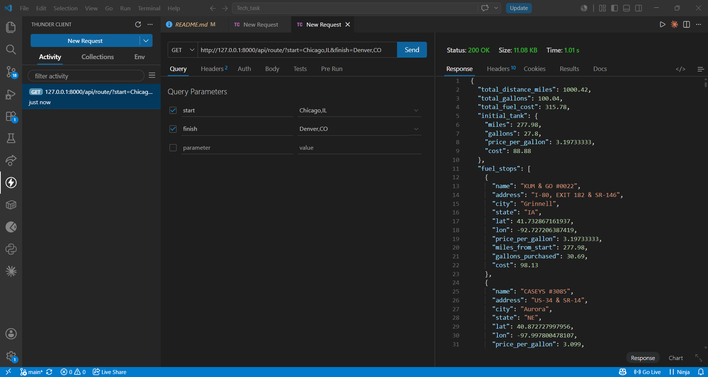

# Spotter Backend Assessment: Route & Fuel Optimizer

An intelligent API built with Django and Django REST Framework that calculates the most cost-effective fuel stops for a journey across the USA. 

## 🚀 Overview
This service takes a `start` and `finish` location, fetches the geographic route, and runs a spatial optimization algorithm against a database of fuel stations to determine exactly where a vehicle should stop to minimize total fuel cost.

It assumes:
- The vehicle has a maximum range of **500 miles**.
- The vehicle achieves **10 miles per gallon (MPG)**.

## ✨ Key Features
* **Optimal Fuel Strategy:** Utilizes a greedy lookahead algorithm to dynamically find the cheapest gas stations within the vehicle's safe range.
* **GeoJSON Route Generation:** Returns a sub-sampled GeoJSON LineString (`route_geojson`) representing the exact driving route while maintaining a small payload size.
* **Interactive HTML Map Viewer:** An included `/api/route/map/` endpoint instantly plots the route and displays fuel stops with detailed popups via Leaflet.js.
* **Smart Data Ingestion:** Safely handles the provided ~8,000 messy truck stop addresses by batch-geocoding them via the US Census Bureau API, bypassing strict rate-limits found in most free-tier geocoders (like Nominatim/OSRM).

## 🧠 Algorithm & Architecture
1. **Geocoding & Routing:** The API calls OpenRouteService to convert the start/finish strings into precise coordinates and requests the optimal driving route.
2. **Spatial Projection:** The algorithm samples the route's polyline and calculates the distance from the route to the geocoded fuel stations in the database to find stations that are strictly along the path (within a 5-mile radius).
3. **Greedy Optimization:** Starting from the origin, the algorithm scans forward in 500-mile chunks. It identifies all reachable stations, selects the absolute cheapest one, and "buys" enough fuel to reach the next optimal stop, guaranteeing the cheapest possible sequence without running out of gas.

**Assumption:** The vehicle is assumed to require an initial tank to cover the distance from the start location to the very first fuel stop. For cost accounting, this initial tank is priced at the first fuel stop's price per gallon.


## 📈 Scalability & Performance
The API response time is highly optimized and typically runs in **<1 second**. This is achieved by loading the fuel stations into a **Spatial Index (`scipy.spatial.cKDTree`)** in memory during application startup. Instead of iterating through coordinates mathematically, the API rapidly queries the KDTree for stations within the 5-mile radius of the route.

**For a massive scale production environment, this could be further optimized by:**
* Migrating from SQLite and in-memory KDTrees to **PostgreSQL with PostGIS**.
* Offloading the geographic math entirely to a native PostGIS spatial query (e.g., `ST_DWithin` on the route's `ST_LineString`).

---

## 🛠️ Setup & Installation

**1. Clone & Setup Virtual Environment**
```bash
python -m venv venv
venv\Scripts\activate
pip install -r requirements.txt # (or install django djangorestframework requests geopy django-environ)
```

**2. Environment Variables**
Create a `.env` file in the root directory and add your OpenRouteService API Key:
```env
ORS_API_KEY=your_api_key_here
DEBUG=True
SECRET_KEY=your_secret_key
```

**3. Run Migrations & Load Data**
```bash
python manage.py migrate
# Load the CSV into the database
python manage.py load_csv
# Batch Geocode the stations using the US Census API
python manage.py geocode_batch
```

**4. Start the Server**
```bash
python manage.py runserver
```

---

## 📡 API Usage
**Endpoint:** `/api/route/`
**Method:** `GET`

### Request Example
```bash
curl -X GET "http://127.0.0.1:8000/api/route/?start=Chicago,IL&finish=Denver,CO"
```



### Success Response (200 OK)
```json
{
    "total_distance_miles": 1000.42,
    "total_gallons": 100.04,
    "total_fuel_cost": 315.78,
    "initial_tank": {
        "miles": 277.98,
        "gallons": 27.8,
        "price_per_gallon": 3.19733333,
        "cost": 88.88
    },
    "fuel_stops": [
        {
            "name": "KUM & GO #0022",
            "address": "I-80, EXIT 182 & SR-146",
            "city": "Grinnell",
            "state": "IA",
            "lat": 41.732867161937,
            "lon": -92.727206387419,
            "price_per_gallon": 3.19733333,
            "miles_from_start": 277.98,
            "gallons_purchased": 30.69,
            "cost": 98.13
        },
        {
            "name": "CASEYS #3085",
            "address": "US-34 & SR-14",
            "city": "Aurora",
            "state": "NE",
            "lat": 40.872727997956,
            "lon": -97.997800478107,
            "price_per_gallon": 3.099,
            "miles_from_start": 584.88,
            "gallons_purchased": 41.55,
            "cost": 128.78
        }
    ],
    "meta": {
        "processing_time_seconds": 0.3082,
        "assumption": "Initial tank is priced at the first stop's price per gallon."
    },
    "route_geojson": {
        "type": "LineString",
        "coordinates": [
            [-87.66063, 41.87899],
            [-87.66731, 41.87888],
            "... (max 500 points) ..."
        ]
    }
}
```

### Interactive Map Example
You can visualize the exact route and stops by opening the map endpoint in a browser:
```text
http://127.0.0.1:8000/api/route/map/?start=Chicago,IL&finish=Denver,CO
```
